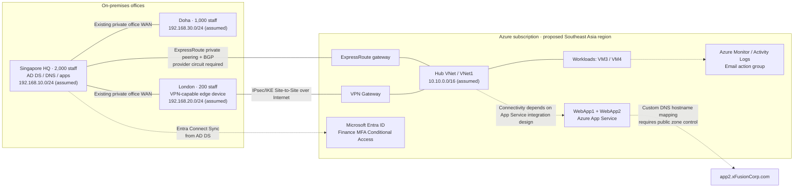

# xFusionCorp Proposed Hybrid Architecture

**Conceptual diagram — simulated names and IP ranges, not deployed resources.**

## Notes

- Office headcounts and existing private inter-office links come from the case study.
- The diagram is **logical**, not a promise of network transit between ExpressRoute and VPN sites. If route transit between connected offices is required, evaluate supported hub routing, Azure Route Server, gateway coexistence settings and on-premises routing.
- Entra Connect Sync is shown logically; it requires an appropriately managed environment and connectivity.
- App Service is a managed platform, not a VM in the workload subnet. VNet Integration and private endpoint requirements depend on application access needs.
- VM3 connectivity over TCP 8080 requires routes and permission at both ends.
